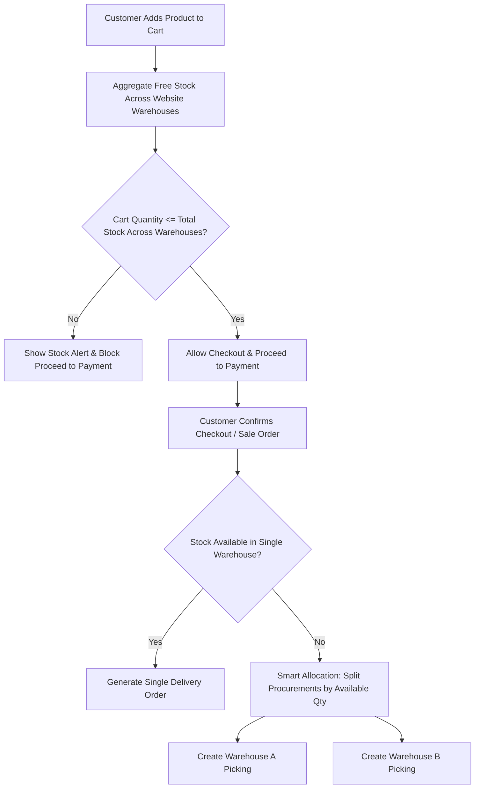

# 🏢 Odoo 18 Multi-Warehouse Fulfillment & Cart Stock Validation

A comprehensive Odoo 18 module that unifies **Multi-Warehouse eCommerce fulfillment**, **intelligent order splitting**, and **real-time cart stock availability validation & payment blocking**.

---

## 🌟 Key Features

### 1. 🌐 Multi-Warehouse eCommerce Stock & Fulfillment
- **Multi-Facility Website Mapping:** Link multiple warehouses to any eCommerce website under *Website Settings*.
- **Aggregated Stock Visibility:** Calculates real-time total available free stock across all designated warehouses rather than relying on a single default location.
- **Automated Order Splitting:** When an order contains items distributed across different warehouses, the system intelligently splits procurements based on on-hand stock and generates separate delivery orders (`stock.picking`) per fulfillment center.

### 2. 🛒 Cart Stock Availability & Payment Protection
- **Simple Customer Stock Status:** Displays clear stock indicators (🟢 *In Stock* vs 🔴 *Out of Stock*) without exposing internal warehouse names or facility details to customers.
- **Over-Quantity Prevention:** If a customer adds more items than the total free stock available across all mapped warehouses:
  - An alert banner is displayed warning them that the requested quantity exceeds available stock.
  - The cart line indicates the available vs requested quantity.
  - The **Proceed to Checkout** button is automatically disabled.
  - Access to payment (`/shop/checkout`, `/shop/payment`) is completely blocked, redirecting them back to `/shop/cart` until quantities are adjusted.

---

## 📐 Architecture & Workflow

---
