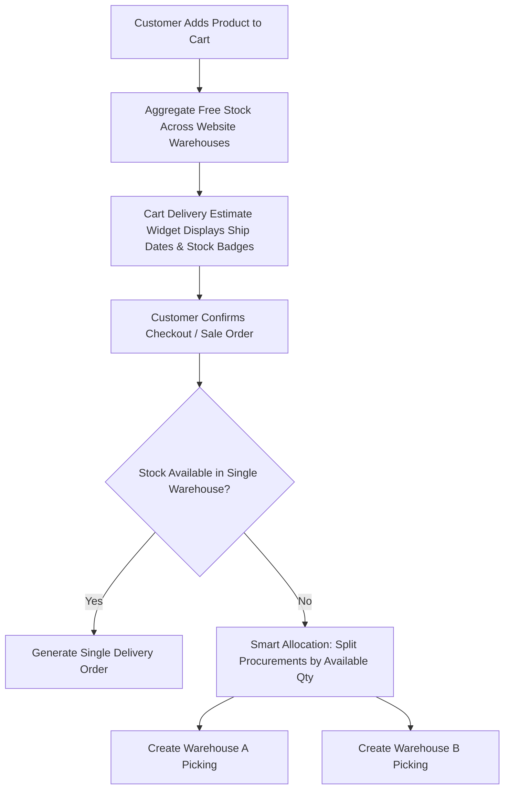

# 🏢 Odoo 18 Multi-Warehouse Fulfillment

A comprehensive enterprise-grade Odoo 18 module that unifies **Multi-Warehouse eCommerce fulfillment**, **intelligent order splitting**, and **real-time cart shipping estimates**.

---

## 🌟 Key Features

### 1. 🌐 Multi-Warehouse eCommerce Stock & Fulfillment
- **Multi-Facility Website Mapping:** Link multiple warehouses to any eCommerce website under *Website Settings*.
- **Aggregated Stock Visibility:** Calculates real-time total available free stock across all designated warehouses rather than relying on a single default location.
- **Automated Order Splitting:** When an order contains items distributed across different warehouses, the system intelligently splits procurements based on on-hand stock and generates separate delivery orders (`stock.picking`) per fulfillment center.

### 2. 🚚 Real-Time Cart Delivery Estimates
- **Dynamic Delivery Date Calculation:** Automatically calculates the expected ship date for every cart line using:
  $$\text{Ship Date} = \text{Today} + \text{Warehouse Security Lead Time} + \text{Product Sales Delay} + 1$$
- **Real-Time Stock Status Badges:**
  - 🟢 **In Stock:** Full inventory available in the warehouse.
  - 🟡 **Partial Stock:** Partially available, split delivery recommended.
  - 🔴 **Out of Stock:** Automatically applies backorder lead buffer (+5 days).
- **Location Awareness:** Displays the warehouse name and city directly inside the customer's cart.

---

## 📐 Architecture & Workflow

---
