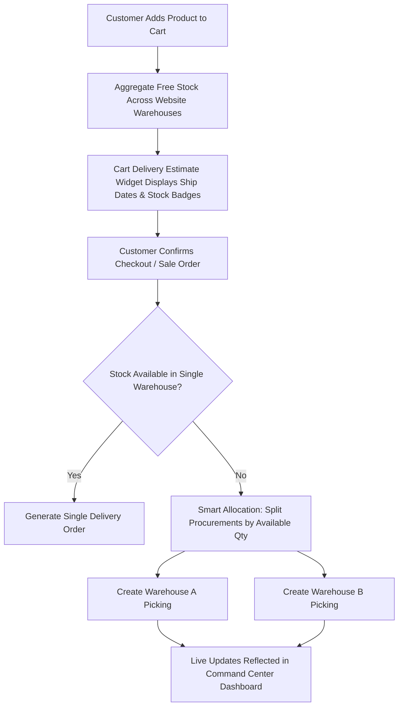

# 🏢 Odoo 18 Multi-Warehouse Fulfillment & Command Center Dashboard

[](https://www.odoo.com)
[](https://www.python.org/)
[-6366F1.svg?style=flat-square)](https://github.com/odoo/owl)
[](https://www.gnu.org/licenses/lgpl-3.0)

A comprehensive enterprise-grade Odoo 18 module that unifies **Multi-Warehouse eCommerce fulfillment**, **intelligent order splitting**, **real-time cart shipping estimates**, and an **interactive OWL 2 Command Center dashboard**.

---

## 🌟 Key Features

### 1. 🌐 Multi-Warehouse eCommerce Stock & Fulfillment
- **Multi-Facility Website Mapping:** Link multiple warehouses to any eCommerce website under *Website Settings*.
- **Aggregated Stock Visibility:** Calculates real-time total available free stock across all designated warehouses rather than relying on a single default location.
- **Automated Order Splitting:** When an order contains items distributed across different warehouses, the system intelligently splits procurements based on on-hand stock and generates separate delivery orders (`stock.picking`) per fulfillment center.

### 2. 🚚 Real-Time Cart Delivery Estimates
- **Dynamic Delivery Date Calculation:** Automatically calculates the expected ship date for every cart line using:
  $$\text{Ship Date} = \text{Today} + \text{Warehouse Security Lead Time} + \text{Product Sales Delay} + 1$$
- **Real-Time Stock Status Badges:**
  - 🟢 **In Stock:** Full inventory available in the warehouse.
  - 🟡 **Partial Stock:** Partially available, split delivery recommended.
  - 🔴 **Out of Stock:** Automatically applies backorder lead buffer (+5 days).
- **Location Awareness:** Displays the warehouse name and city directly inside the customer's cart.

### 3. 🏭 Warehouse Command Center (OWL 2 Dashboard)
Located under **Inventory → Reporting → Warehouse Command Center**:
- **Modern Glassmorphism UI:** Built with OWL 2 and modern CSS backdrop filters, glowing accent gradients, and dark mode palette.
- **Live KPI Strip:**
  - Active Warehouses Count
  - Total Distinct SKUs in Stock
  - Pending Operations (`assigned`, `waiting`, `confirmed`)
  - Pickings Completed Today
  - Overdue Shipments & Receipts
- **Warehouse Health Cards:**
  - Individual cards for each warehouse tracking pending, completed, overdue, products, and total unit count.
  - Dynamic storage utilization bar with visual warning thresholds ($\ge 80\%$ critical alert).
  - Quick-action click to drill directly into that warehouse’s inventory quants.
- **Low Stock Reorder Alerts:** Identifies products that have breached their minimum reorder point (`orderpoint`).
- **Top 5 Movers (30 Days):** Leaderboard ranking the fastest-moving products with gold, silver, and bronze badges.
- **Recent Transfers Feed:** Live activity log of recently completed pickings with partner and SKU counts.
- **Live Refresh:** One-click AJAX sync with timestamp indicator.

---

## 📐 Architecture & Workflow



---

## 📂 Repository Structure

```text
2302031800117-MINORPROJECT/
├── README.md
├── .gitignore
└── trdo_multi_warehouse/
    ├── __init__.py
    ├── __manifest__.py
    ├── controllers/
    │   ├── __init__.py
    │   └── main.py                     # JSON RPC routes for Dashboard & Cart Delivery
    ├── models/
    │   ├── __init__.py
    │   ├── res_config_setting.py       # Website warehouse configuration
    │   ├── sale_order.py               # Stock aggregation & order procurement splitting
    │   ├── sale_order_delivery.py      # Lead time & estimated ship date engine
    │   ├── warehouse_dashboard.py      # Transient model computing live dashboard metrics
    │   └── warehouse_multi.py          # Website warehouse many2many extension
    ├── security/
    │   └── ir.model.access.csv         # Access control lists for dashboard model
    ├── static/
    │   └── src/
    │       ├── css/
    │       │   └── warehouse_dashboard.css  # Dark glassmorphism styling
    │       ├── js/
    │       │   └── warehouse_dashboard.js   # OWL 2 Component logic
    │       └── xml/
    │           └── warehouse_dashboard.xml  # OWL 2 Component templates
    └── views/
        ├── cart_delivery_template.xml       # eCommerce cart QWeb extension
        ├── dashboard_action.xml             # Backend client action & menu definition
        └── res_config_setting.xml           # Website settings view extension
```

---

## ⚙️ Installation & Setup

### Prerequisites
- Odoo 18.0 (Community or Enterprise)
- Python 3.12+
- PostgreSQL 14+
- Dependencies: `website_sale`, `website_sale_stock`, `stock`, `mail`

### Steps
1. **Clone the repository into your custom addons directory:**
   ```bash
   cd /path/to/odoo/custom_addons
   git clone https://github.com/sujalmansuri1/2302031800117-MINORPROJECT.git
   ```

2. **Add the path to your Odoo configuration file (`odoo.conf`):**
   ```ini
   addons_path = /path/to/odoo/addons,/path/to/odoo/custom_addons/2302031800117-MINORPROJECT
   ```

3. **Install the module:**
   - Restart the Odoo server:
     ```bash
     python3 odoo-bin -c /path/to/odoo.conf -u trdo_multi_warehouse
     ```
   - Alternatively, navigate to **Apps**, click **Update Apps List**, search for `Website Multi Warehouse`, and click **Activate / Upgrade**.

---

## 🚀 Configuration Guide

### 1. Assign Warehouses to Websites
1. Navigate to **Website → Configuration → Settings**.
2. Under the **Shop - Multi Warehouse** section, select the fulfillment warehouses associated with this website.
3. Click **Save**.

### 2. Access the Command Center Dashboard
1. Go to **Inventory → Reporting → Warehouse Command Center**.
2. View real-time KPIs, warehouse storage capacity utilization, reorder alerts, and recent transfers.
3. Click any warehouse card to inspect live inventory levels.

### 3. Customer Cart Experience
1. Open the eCommerce shop and add products to the cart.
2. Navigate to `/shop/cart`.
3. Each line item will show estimated delivery dates with warehouse status badges (🟢 *In Stock*, 🟡 *Partial Stock*, 🔴 *Out of Stock*).

---

## 📄 License
This project is licensed under the **LGPL-3** License.