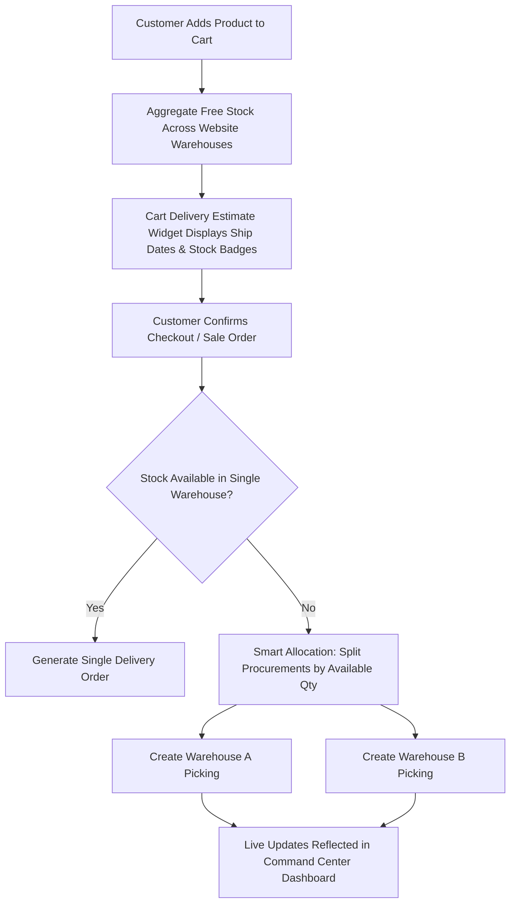

# 🏢 Odoo 18 Multi-Warehouse Fulfillment & Command Center Dashboard

[-6366F1.svg?style=flat-square)](https://github.com/odoo/owl)

A comprehensive enterprise-grade Odoo 18 module that unifies **Multi-Warehouse eCommerce fulfillment**, **intelligent order splitting**, **real-time cart shipping estimates**, and an **interactive OWL 2 Command Center dashboard**.

---

## 🌟 Key Features

### 1. 🌐 Multi-Warehouse eCommerce Stock & Fulfillment
- **Multi-Facility Website Mapping:** Link multiple warehouses to any eCommerce website under *Website Settings*.
- **Aggregated Stock Visibility:** Calculates real-time total available free stock across all designated warehouses rather than relying on a single default location.
- **Automated Order Splitting:** When an order contains items distributed across different warehouses, the system intelligently splits procurements based on on-hand stock and generates separate delivery orders (`stock.picking`) per fulfillment center.

### 2. 🚚 Real-Time Cart Delivery Estimates
- **Dynamic Delivery Date Calculation:** Automatically calculates the expected ship date for every cart line using:
  $$\text{Ship Date} = \text{Today} + \text{Warehouse Security Lead Time} + \text{Product Sales Delay} + 1$$
- **Real-Time Stock Status Badges:**
  - 🟢 **In Stock:** Full inventory available in the warehouse.
  - 🟡 **Partial Stock:** Partially available, split delivery recommended.
  - 🔴 **Out of Stock:** Automatically applies backorder lead buffer (+5 days).
- **Location Awareness:** Displays the warehouse name and city directly inside the customer's cart.

### 3. 🏭 Warehouse Command Center (OWL 2 Dashboard)
Located under **Inventory → Reporting → Warehouse Command Center**:
- **Modern Glassmorphism UI:** Built with OWL 2 and modern CSS backdrop filters, glowing accent gradients, and dark mode palette.
- **Live KPI Strip:**
  - Active Warehouses Count
  - Total Distinct SKUs in Stock
  - Pending Operations (`assigned`, `waiting`, `confirmed`)
  - Pickings Completed Today
  - Overdue Shipments & Receipts
- **Warehouse Health Cards:**
  - Individual cards for each warehouse tracking pending, completed, overdue, products, and total unit count.
  - Dynamic storage utilization bar with visual warning thresholds ($\ge 80\%$ critical alert).
  - Quick-action click to drill directly into that warehouse’s inventory quants.
- **Low Stock Reorder Alerts:** Identifies products that have breached their minimum reorder point (`orderpoint`).
- **Top 5 Movers (30 Days):** Leaderboard ranking the fastest-moving products with gold, silver, and bronze badges.
- **Recent Transfers Feed:** Live activity log of recently completed pickings with partner and SKU counts.
- **Live Refresh:** One-click AJAX sync with timestamp indicator.

---

## 📐 Architecture & Workflow

---
